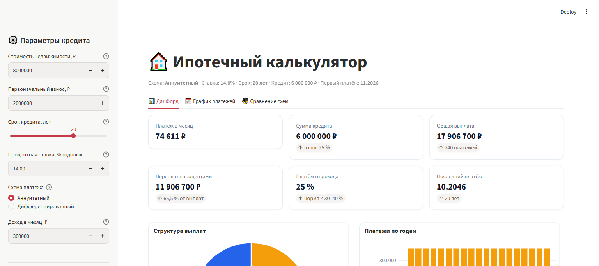

# 🏠 Ипотечный калькулятор с дашбордом

Интерактивный ипотечный калькулятор: считает платежи по кредиту и показывает
полную картину займа — дашборд с графиками, схемами движения средств,
помесячным графиком платежей и сравнением двух схем платежа.

Проект предназначен для подготовки расчётов по ипотеке: менеджер или клиент
задаёт параметры кредита и сразу видит размер платежа, переплату, нагрузку
на бюджет и выгоду выбора той или иной схемы.

---

## Возможности

**Параметры** (боковая панель): стоимость недвижимости, первоначальный взнос,
срок кредита, процентная ставка, схема платежа, ежемесячный доход.

**📊 Дашборд**
- 6 KPI-метрик: платёж в месяц, сумма кредита, общая выплата, переплата,
  кредитная нагрузка (платёж от дохода), дата последнего платежа;
- кольцевая диаграмма — структура всех выплат (тело долга против процентов);
- столбчатая диаграмма — платежи по календарным годам;
- график — остаток долга, накопленные проценты и погашенный основной долг;
- **схема-сетка (heatmap)** — доля основного долга в каждом платеже
  по годам и месяцам периода;
- **схема Санки** — движение средств: первоначальный взнос + кредит → жильё,
  проценты → доход банка.

**📅 График платежей** — помесячная амортизационная таблица (платёж, тело,
проценты, остаток), итоги по календарным годам, итоговая строка и выгрузка CSV.

**⚖️ Сравнение схем** — аннуитетный против дифференцированного платежа:
график платежей, переплата и сводная таблица.

**🎨 Две темы оформления** — светлая и тёмная; тема переключается в шапке
боковой панели и меняет цвет всего интерфейса и графиков.

---

## Интерфейс



Приложение открывается одной страницей с тремя вкладками:

| Вкладка | Что показывает |
|---|---|
| **📊 Дашборд** | KPI-метрики и все графики: структура выплат, платежи по годам, динамика остатка долга, heatmap и схема Санки |
| **📅 График платежей** | Помесячная таблица платежей, годовые итоги, кнопка выгрузки в CSV |
| **⚖️ Сравнение схем** | Сравнение аннуитетного и дифференцированного платежа: графики, метрики и сводная таблица |

Слева — боковая панель с параметрами кредита и переключателем темы.
Любое изменение параметров мгновенно пересчитывает все графики и таблицы.

---

## Системные требования

| Компонент | Минимум |
|---|---|
| ОС | Windows 10/11, macOS, Linux |
| Python | **3.10 или новее** (проверено на 3.15) |
| Диск | ~100 МБ (пакеты Python) + место под сам проект |
| ОЗУ | 2 ГБ |
| Браузер | Chrome, Firefox, Edge или Safari актуальной версии |
| Интернет | Нужен только при установке зависимостей; работа офлайн |

Доступ в интернет, база данных и дополнительные сервисы **не требуются**.

---

## Установка с чистого компьютера

Все команды копируются целиком. Если у вас Windows — откройте **PowerShell**,
если macOS/Linux — **терминал**.

### 1. Установите Python

Скачайте Python 3.10+ с [python.org](https://www.python.org/downloads/) и
запустите установщик. На Windows обязательно отметьте галочку
**«Add python.exe to PATH»**.

Проверка:

```bash
python --version
```

Должна вывести версию `Python 3.10.x` или выше.

### 2. Получите код проекта

**Вариант A — клонирование (рекомендуется, нужен Git):**

```bash
git clone git@gitverse.ru:Iveta/dashboard_ipoteka.git
cd dashboard_ipoteka
```

**Вариант B — скачивание архива:** на странице репозитория нажмите
**«Скачать»** → распакуйте архив и перейдите в распакованную папку:

```bash
cd dashboard_ipoteka
```

### 3. Создайте виртуальное окружение

Виртуальное окружение изолирует зависимости проекта от остальной системы —
другие программы на компьютере не пострадают.

Windows (PowerShell):

```powershell
python -m venv .venv
Set-ExecutionPolicy -Scope Process -ExecutionPolicy RemoteSigned -Force
.venv\Scripts\Activate.ps1
```

macOS / Linux:

```bash
python3 -m venv .venv
source .venv/bin/activate
```

> **Windows.** Строка `Set-ExecutionPolicy` снимает запрет PowerShell
> на запуск скриптов активации — без неё команда `Activate.ps1` завершится
> ошибкой *«Не удалось загрузить файл …Activate.ps1»*. Политика действует
> только для текущего окна терминала и не меняет настройки системы.
> Если политика задана организацией и команда не проходит — окружение
> можно не активировать: используйте полный путь к Python из окружения,
> например `.venv\Scripts\python.exe -m streamlit run app.py`.

При успешной активации в начале строки появится `(.venv)`.

### 4. Установите зависимости

С активированным окружением выполните:

```bash
python -m pip install --upgrade pip
python -m pip install -r requirements.txt
```

Установка занимает 1–3 минуты.

---

## Запуск

С активированным виртуальным окружением:

```bash
python -m streamlit run app.py
```

В консоли появятся адреса:

```
Local URL: http://localhost:8501
```

Откройте `http://localhost:8501` в браузере. Для остановки — `Ctrl+C`
в окне консоли.

Запуск без виртуального окружения (если зависимости установлены глобально):

```bash
streamlit run app.py
```

---

## Структура файлов

```
dashboard_ipoteka/
├── app.py              # интерфейс Streamlit: панель параметров, вкладки, графики Plotly
├── mortgage.py         # ядро расчётов: формулы платежей, график, годовая агрегация
├── test_mortgage.py    # автотесты ядра расчётов
├── requirements.txt    # список зависимостей
├── README.md           # этот файл
├── docs/
│   └── screenshot.png  # скриншот интерфейса
└── .gitignore          # файлы, которые не попадают в репозиторий
```

| Файл | Назначение |
|---|---|
| `mortgage.py` | Формулы аннуитетного и дифференцированного платежа, построение графика, годовая агрегация, сравнение схем |
| `app.py` | Весь внешний вид и логика страницы: ввод параметров, три вкладки, графики, таблицы, темы оформления |
| `test_mortgage.py` | Проверка правильности расчётов |
| `requirements.txt` | Версии библиотек, которые нужно установить |

Изменения в интерфейсе (`app.py`) не затрагивают расчёты (`mortgage.py`),
и наоборот.

---

## Проверка работоспособности

### Автоматические тесты

```bash
python test_mortgage.py
```

Ожидаемый вывод:

```
Все проверки пройдены ✔
```

Тесты сверяют аннуитет с эталонной формулой, проверяют закрытие баланса,
равенство суммы тела долга кредиту, монотонность дифференцированного платежа
и сходимость годовой агрегации с помесячным графиком. Если строка
«Все проверки пройдены» не появилась — расчёты работают неверно,
обратитесь к разделу [Если что-то не работает](#если-что-то-не-работает).

### Ручная проверка за 1 минуту

1. Запустите приложение и откройте `http://localhost:8501`.
2. На вкладке **📊 Дашборд** убедитесь, что видите 6 метрик и 5 графиков.
3. Измените **процентную ставку** в боковой панели — цифры метрик и все
   графики должны пересчитаться.
4. Перейдите на вкладку **📅 График платежей** — таблица должна содержать
   строки помесячных платежей, внизу итоговая строка «ИТОГО».
5. Нажмите **⬇️ Скачать CSV** — файл должен скачаться и открываться в Excel.
6. На вкладке **⚖️ Сравнение схем** убедитесь, что присутствуют обе
   схемы платежа и сводная таблица.
7. В шапке боковой панели переключите тему на 🌙 **Тёмная** — интерфейс
   должен перекраситься, текст остаться читаемым.

Если все 7 пунктов выполнены — приложение работает штатно.

---

## Переменные окружения

Приложение **не требует** собственных переменных окружения: все настройки
задаются в интерфейсе и в файле `requirements.txt`.

Дополнительно могут быть переопределены стандартные переменные Streamlit
(перечислены только имена, значения подбираются под вашу среду):

- `STREAMLIT_SERVER_PORT`
- `STREAMLIT_SERVER_ADDRESS`
- `STREAMLIT_SERVER_HEADLESS`
- `STREAMLIT_BROWSER_GATHER_USAGE_STATS`
- `STREAMLIT_THEME_BASE`

Пример задания (Windows, PowerShell):

```powershell
$env:STREAMLIT_SERVER_PORT = "8501"
```

Пример задания (macOS / Linux):

```bash
export STREAMLIT_SERVER_PORT=8501
```

---

## Деплой

### Вариант 1. Выделенный сервер (Linux)

```bash
# 1. Установите Python и клонируйте проект
sudo apt update
sudo apt install -y python3 python3-venv git
git clone git@gitverse.ru:Iveta/dashboard_ipoteka.git
cd dashboard_ipoteka

# 2. Виртуальное окружение и зависимости
python3 -m venv .venv
source .venv/bin/activate
python -m pip install -r requirements.txt

# 3. Запуск (порт 8501, доступен извне)
python -m streamlit run app.py --server.address 0.0.0.0 --server.port 8501
```

Для постоянной работы добавьте приложение в `systemd`-юнит или используйте
процесс-менеджер (supervisor, pm2). Порт 8501 должен быть открыт
в файрволе.

### Вариант 2. Docker

Создайте файл `Dockerfile` в корне проекта:

```dockerfile
FROM python:3.12-slim
WORKDIR /app
COPY requirements.txt .
RUN pip install --no-cache-dir -r requirements.txt
COPY . .
EXPOSE 8501
CMD ["streamlit", "run", "app.py", "--server.address", "0.0.0.0", "--server.port", "8501"]
```

Сборка и запуск:

```bash
docker build -t dashboard-ipoteka .
docker run -d -p 8501:8501 --name dashboard-ipoteka dashboard-ipoteka
```

### Вариант 3. Streamlit Community Cloud

1. Загрузите проект в публичный репозиторий GitVerse (уже выполнен).
2. Откройте [share.streamlit.io](https://share.streamlit.io/) и подключите
   репозиторий.
3. В настройках укажите главный файл `app.py`.
4. Запустите — Streamlit Cloud сам установит зависимости
   из `requirements.txt`.

---

## Обновление

Обновление — это обычное обновление из репозитория. Все изменения,
которые вы или ваши коллеги внесли на GitVerse, подтягиваются локально.

```bash
cd dashboard_ipoteka
git pull
python -m pip install -r requirements.txt
python test_mortgage.py
python -m streamlit run app.py
```

Если в `requirements.txt` появились новые библиотеки, шаг
`pip install -r requirements.txt` обязателен — без него приложение
не запустится.

---

## Резервное копирование

**Источник истины — репозиторий GitVerse.** Проект не хранит баз данных
и пользовательских файлов: все расчёты выполняются «на лету»,
поэтому достаточно резервировать код.

### 1. Отправка изменений (делайте регулярно)

```bash
cd dashboard_ipoteka
git add -A
git commit -m "описание изменений"
git push
```

### 2. Полная локальная копия репозитория (с историей)

```bash
git bundle create dashboard_ipoteka_backup.bundle --all
```

Файл `dashboard_ipoteka_backup.bundle` — самодостаточная копия всего
репозитория с историей. Храните его на другом диске или в облачном
хранилище. Восстановление из бандла:

```bash
git clone dashboard_ipoteka_backup.bundle dashboard_ipoteka_restored
```

### 3. Простая копия файлов (без истории Git)

```bash
git archive -o dashboard_ipoteka_files.zip HEAD
```

### Что не нужно копировать

- `.venv/` — воссоздаётся из `requirements.txt`;
- `__pycache__/` — служебные файлы Python;
- скриншоты и временные файлы.

---

## Известные ограничения

- **Расчёты носят справочный характер.** Банк может использовать другие
  формулы (365/366 дней, округление в большую сторону, дополнительные
  комиссии), поэтому итоговые суммы у конкретного банка могут отличаться.
- **Нет учёта дополнительных расходов:** страховки, оценки, регистрации
  сделки, комиссий за досрочное погашение — они не моделируются.
- **Нет сохранения расчётов.** Все данные вводятся заново при каждом
  запуске; постоянного хранения (базы данных) нет.
- **Нет аутентификации и прав доступа.** Приложение рассчитано на работу
  доверенных пользователей; при публичном деплое закройте его
  авторизацией на уровне reverse proxy.
- **График платежей фиксирован по месяцам** с датой первого платежа
  — сегодняшней датой; произвольная дата начала в интерфейсе не задаётся.
- **Кегль и темы оформлены для desktop-браузеров**; на очень маленьких
  экранах (менее 1024 px по ширине) вёрстка может сжиматься.
- **Одна сессия — один расчёт:** параллельная работа нескольких
  пользователей на одном экземпляре возможна, но данные между
  сессиями не передаются.

---

## Если что-то не работает

Сначала посмотрите **текст ошибки в консоли**, где запускалось приложение,
и в браузере (красное сообщение на странице). Дальше — по симптомам.

### `python` не найден или версия ниже 3.10

```bash
python --version
```

Установите Python 3.10+ с [python.org](https://www.python.org/downloads/)
и при установке на Windows отметьте **«Add python.exe to PATH»**.
Если Python уже стоит, но не виден — перезапустите терминал.

### `Fatal error in launcher` / `streamlit` не найден

Зависимости не установлены или окружение не активировано:

```powershell
python -m venv .venv
Set-ExecutionPolicy -Scope Process -ExecutionPolicy RemoteSigned -Force
.venv\Scripts\Activate.ps1
python -m pip install -r requirements.txt
python -m streamlit run app.py
```

(На macOS / Linux вместо первых трёх команд Windows — `python3 -m venv .venv`
и `source .venv/bin/activate`.)

### Ошибка «Не удалось загрузить файл …Activate.ps1»

PowerShell запрещает запуск скриптов активации. Выполните перед активацией:

```powershell
Set-ExecutionPolicy -Scope Process -ExecutionPolicy RemoteSigned -Force
```

Она действует только для текущего окна. Если и она не помогает — обходите
активацию полностью, вызывая Python из окружения напрямую:

```powershell
.venv\Scripts\python.exe -m streamlit run app.py
```

### `ModuleNotFoundError: No module named '...'`

Не установлены зависимости. С активированным окружением:

```bash
python -m pip install -r requirements.txt
```

### `Permission denied` или «адрес уже занят» при запуске

Порт 8501 занят другим процессом. Запустите на другом порту:

```bash
python -m streamlit run app.py --server.port 8502
```

### Ошибка при `pip install` (нет доступа к сети / таймаут)

Проверьте подключение к интернету и повторите:

```bash
python -m pip install --upgrade pip
python -m pip install -r requirements.txt
```

За корпоративным прокси можно указать зеркало:

```bash
python -m pip install -r requirements.txt -i https://pypi.org/simple
```

### `git clone` просит пароль или отклоняет ключ

Проверьте, что SSH-ключ добавлен в профиль GitVerse, и что remote
указан верно:

```bash
git remote -v
```

Ожидаемо: `git@gitverse.ru:Iveta/dashboard_ipoteka.git`.
Исправление remote:

```bash
git remote set-url origin git@gitverse.ru:Iveta/dashboard_ipoteka.git
```

### Страница открыта, но пустая или грузится вечно

1. Нажмите в браузере `Ctrl+F5` (принудительная перезагрузка).
2. Убедитесь, что в консоли Streamlit нет сообщений об ошибках.
3. Попробуйте другой браузер.
4. Проверьте ручную проверку из раздела
   [Проверка работоспособности](#проверка-работоспособности) —
   если графики не реагируют на изменение ставки, приложение упало:
   посмотрите консоль.

### Тесты не проходят

```bash
python test_mortgage.py
```

Если вместо «Все проверки пройдены ✔» выводится `AssertionError` —
код расчётов был изменён и ломает формулы. Восстановите последнюю
рабочую версию:

```bash
git status
git log --oneline -5
git stash
python test_mortgage.py
```

### Ничего из перечисленного не помогло

Соберите информацию и передайте разработчику:

```bash
python --version
python -m pip list
git log --oneline -5
git status
```

Текст ошибки из консоли и скриншот страницы с ошибкой.

---

## Как считается

- **Аннуитетный платёж** (постоянный весь срок):

  `P = S · i / (1 − (1 + i)^-n)`, где `i` — месячная ставка, `n` — число месяцев.
  Последний платёж корректируется, чтобы закрыть остаток с точностью до копейки.

- **Дифференцированный платёж**: тело долга гасится равными частями
  (`S / n`), проценты начисляются на остаток, поэтому платёж убывает
  от максимального к минимальному.

При нулевой ставке проценты не начисляются, платёж равен `S / n`.
